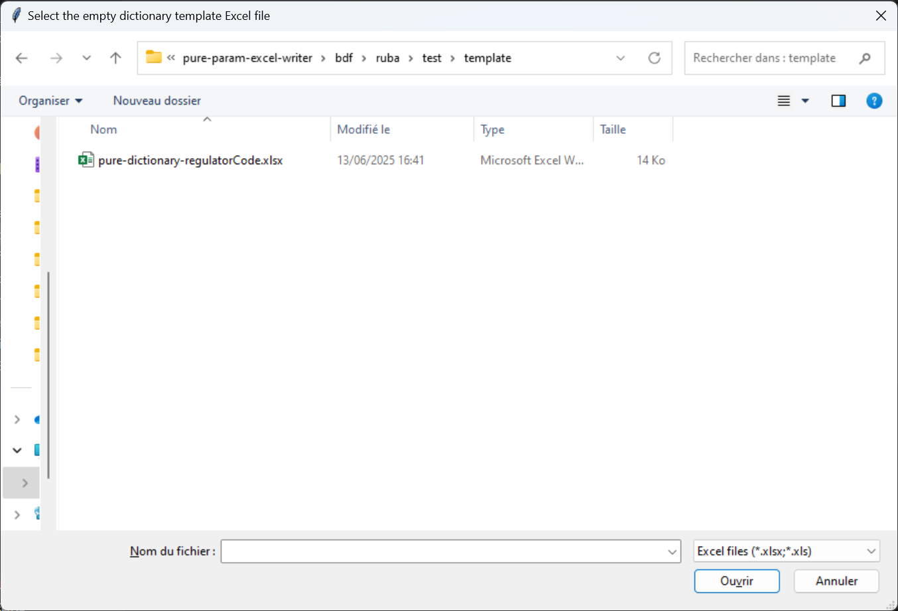
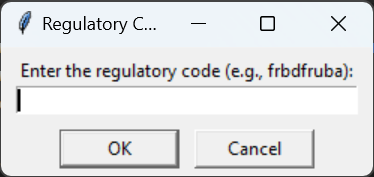
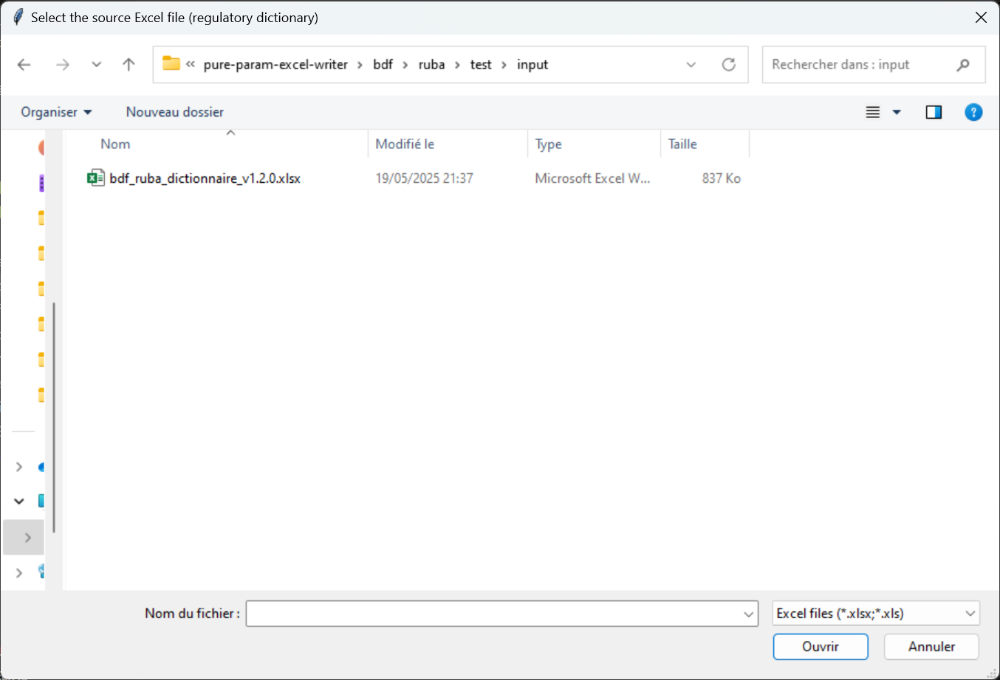

# pure-param-excel-writer

- [pure-param-excel-writer](#pure-param-excel-writer)
  - [Project Structure](#project-structure)
  - [Running Python Scripts on Windows](#running-python-scripts-on-windows)
    - [1. Open your command prompt (CMD) or PowerShell](#1-open-your-command-prompt-cmd-or-powershell)
    - [2. Navigate to the project directory](#2-navigate-to-the-project-directory)
    - [3. Create and activate a virtual environment](#3-create-and-activate-a-virtual-environment)
    - [4. Install project dependencies](#4-install-project-dependencies)
    - [5. Executing the specific script](#5-executing-the-specific-script)
  - [New Tools — Form Enrichment](#new-tools--form-enrichment)
    - [Unified  (`pure_form_generator.py`)](#unified-pure_form_generatorpy)
    - [Enrichment Tool (`enrichment_tool.py`)](#enrichment-tool-enrichment_toolpy)
    - [Z-Axis Tool (`zaxis_tool.py`)](#z-axis-tool-zaxis_toolpy)
    - [Datatype Tool (`datatype_tool.py`)](#datatype-tool-datatype_toolpy)
    - [RowKey Tool (`rowkey_tool.py`)](#rowkey-tool-rowkey_toolpy)
  - [EBA Scripts Description](#eba-scripts-description)
    - [Forms Generation from DPM (`forms_from_dpm.py`)](#forms-generation-from-dpm-forms_from_dpmpy)
    - [Identical Cells Controls Generation (`identical_cells.py`)](#identical-cells-controls-generation-identical_cellspy)
  - [BDF Dictionary Script Description](#bdf-dictionary-script-description)
  - [Common Scripts Description](#common-scripts-description)
    - [Feeding Rules Script (`feedingRuleSource_in_forms.py`)](#feeding-rules-script-feedingrulesource_in_formspy)
  - [Report Script Description](#report-script-description)
    - [Pure forms generation Script (`forms_from_report.py`)](#pure-forms-generation-script-forms_from_reportpy)

## Project Structure

This project provides Python scripts for automating the generation and enrichment of PURE (SBP RR) parameterization files. It is organized as follows:

```
pure-param-excel-writer/
│
├── new/                          # NEW — Form enrichment tools
│   ├── pure_form_generator.py    #   Form generator (generation + enrichment + rowKey)
│   ├── enrichment_tool.py        #   Z-axis + datatype enrichment
│   ├── zaxis_tool.py             #   Z-axis standalone tool
│   ├── datatype_tool.py          #   Datatype standalone tool
│   └── rowkey_tool.py            #   RowKey standalone tool
│
├── eba/
│   ├── forms_from_dpm.py         # EBA form generation from DPM
│   └── identical_cells.py        # EBA identical cells controls
│
├── bdf/
│   └── ruba/
│       ├── dictionnary_from_dpm.py       # BDF RUBA dictionary generation
│       ├── forms_from_dpm.py             # BDF RUBA form generation
│       └── allocation_rules_in_forms_from_report.py
│
├── common/
│   ├── feedingRuleSource_in_forms.py     # Feeding rules processor
│   └── excel_logger.py                  # Excel logging utility
│
├── report/
│   ├── forms_from_report.py             # Report-to-PURE form conversion (BNB)
│   └── Mapping_Rub_6_4_digits.xlsx      # Mapping table for row numbering
│
├── template/
│   ├── pure-form-regulatoryOutputCode-formCode-(shortName).xlsm
│   ├── pure-dictionary-regulatorCode.xlsx
│   └── pure-regulation-regulationCode.xlsx
│
├── imgs/                         # Screenshots for documentation
├── requirements.txt
└── README.md
```

**New tools** (in `new/`) work with generated forms and YML dictionaries to automate post-generation enrichment. **Existing tools** (in `eba/`, `bdf/`, `common/`, `report/`) remain available for their original purposes.

## Running Python Scripts on Windows

### 1. Open your command prompt (CMD) or PowerShell

Press `Win + R`, type `cmd` or `powershell`, and press Enter.

### 2. Navigate to the project directory

Use the `cd` command to go to your project folder. For example:

```bash
cd C:\Path\To\PURE-PARAM-EXCEL-WRITER
```

### 3. Create and activate a virtual environment

```bash
python -m venv venv
venv\Scripts\activate
```

> **Important:** Each time you open a new terminal session, you must reactivate the virtual environment before running any script:
> ```bash
> cd C:\Path\To\PURE-PARAM-EXCEL-WRITER
> venv\Scripts\activate
> ```

### 4. Install project dependencies
Make sure the virtual environment is activated, then run:

```bash
pip install -r requirements.txt
```

### 5. Executing the specific script

Open the terminal in Visual Studio Code.
Navigate to the directory where your Python script is located.
Run the script using the following command:

```bash
py <name_of_the_script>.py
```

---

## New Tools — Form Enrichment

These new scripts (located in the `new/` folder) automate the enrichment of generated PURE forms. They read DPM files (Annotated Table Layout `.xlsx`) and YML dictionaries (`pure-dictionary-*.yml`) to populate Z-axis classes, datatypes, and rowKeys in the generated `.xlsm` files.

### Form Generator (`pure_form_generator.py`)

**Purpose:** All-in-one script that orchestrates the complete PURE form generation workflow: DPM form generation → Z-axis + datatype enrichment → RowKey filling. **This is the recommended entry point.**

**Features:**

- Combines `forms_from_dpm.py`, `enrichment_tool.py`, and `rowkey_tool.py` into a single orchestrated run
- GUI mode with file dialogs for selecting DPM source, dictionary, and form template files
- Supports all sub-tool modes independently (enrichment only, rowkey only, etc.)
- Automatic `.bak` backup creation before any file modification
- Loads YML dictionaries to resolve Z-axis types, datatypes, and enum values

**Modes:**

```powershell
# Full run with GUI
py .\new\pure_form_generator.py

# Enrichment report only
py .\new\pure_form_generator.py enrichment

# Enrichment with GUI
py .\new\pure_form_generator.py enrichment --gui

# Write Z-axis + datatypes into XLSM files
py .\new\pure_form_generator.py enrichment --write

# Set Z-axis for a specific sheet
py .\new\pure_form_generator.py enrichment --set-zaxis TYPE --sheet SHEET

# Set datatype for a specific column
py .\new\pure_form_generator.py enrichment --set-datatype TYPE --sheet SHEET --col CODE

# RowKey report only
py .\new\pure_form_generator.py rowkey

# RowKey with GUI
py .\new\pure_form_generator.py rowkey --gui

# Write rowKeys into XLSM files
py .\new\pure_form_generator.py rowkey --write

# Set rowKey for a specific sheet
py .\new\pure_form_generator.py rowkey --set-rowkey "formula" --sheet SHEET
```

---

### Enrichment Tool (`enrichment_tool.py`)

**Purpose:** Unified tool that merges Z-axis and datatype enrichment into a single script. Reads DPM files and YML dictionaries to populate Z-axis classes and datatypes in generated PURE form XLSM files.

**Features:**

- **Z-Axis enrichment:**
  - Reads DPM files (Annotated Table Layout) to find Z-axis variants per sheet
  - Maps DPM variants to dictionary types using `submissionValue` with `eba_<hierarchy>:` prefix
  - Writes J2 (code), J4 (associatedAttribute), and enum values into XLSM files
- **Datatype enrichment:**
  - Reads DPM columns with unit/sign/Main Property information
  - Determines PURE datatype via known mappings and heuristics
  - Writes datatypes into identification J2 and row 7 of XLSM files
- Automatic `.bak` backup creation before any modification
- GUI mode with interactive file selection

**Modes:**

```powershell
# Full report (Z-axis + datatypes)
py .\new\enrichment_tool.py

# Write everything
py .\new\enrichment_tool.py --write

# Z-axis only (report or write)
py .\new\enrichment_tool.py --zaxis-only
py .\new\enrichment_tool.py --write --zaxis-only

# Datatype only (report or write)
py .\new\enrichment_tool.py --datatype-only
py .\new\enrichment_tool.py --write --datatype-only

# GUI mode
py .\new\enrichment_tool.py --gui

# Set Z-axis for a specific sheet
py .\new\enrichment_tool.py --set-zaxis typspelendingexp --sheet K_29.02.a

# Set datatype for a specific column
py .\new\enrichment_tool.py --set-datatype ratio9Dec --sheet C_34.07.TOT --col 0020
```

**Required files (must be in the same directory as the XLSM files):**
- `pure-dictionary-<domain>.yml` — YML dictionary for the target domain
- `pure-form-*.xlsm` — Generated PURE forms
- DPM Annotated Table Layout `.xlsx` — Source DPM file

---

### Z-Axis Tool (`zaxis_tool.py`)

**Purpose:** Standalone tool for retrieving and writing Z-axis classes in PURE form XLSM files. Reads the YML dictionary to find enum values for each Z-axis type.

**Features:**

- Reads all `pure-form-*.xlsm` files in the directory
- For each sheet with a Z-axis (J2 populated), retrieves the type name
- Looks up corresponding enum values in the YML dictionary
- Mode REPORT: displays found classes for each form
- Mode WRITE: writes enum values into the Z-axis zone (rows 5+) of the XLSM
- Mode SET: writes J2 (code) + J4 (associatedAttribute) + enum values for a specific sheet

**Command to run:**

```powershell
# Report mode
py .\new\zaxis_tool.py

# Write mode
py .\new\zaxis_tool.py --write

# Set Z-axis for a specific sheet
py .\new\zaxis_tool.py --set typspelendingexp --sheet K_29.02.a
py .\new\zaxis_tool.py --set exposureClassSub1 --sheet K_29.00
```

---

### Datatype Tool (`datatype_tool.py`)

**Purpose:** Standalone tool for retrieving and writing datatypes per column in PURE form XLSM files. Reads DPM files and the YML dictionary to identify the correct datatype for each column.

**Features:**

- Reads DPM files (Annotated Table Layout `.xlsx`) to extract columns with unit/sign/Main Property
- Looks up corresponding datatypes in the YML dictionary
- Compares with existing PURE form XLSM files to identify missing datatypes
- Mode REPORT: displays found/missing datatypes
- Mode WRITE: writes datatypes into row 7 of XLSM files
- Mode GUI: interactive interface with file and sheet selection

**Command to run:**

```powershell
# Report mode
py .\new\datatype_tool.py

# Write mode
py .\new\datatype_tool.py --write

# GUI mode
py .\new\datatype_tool.py --gui

# Set datatype for a specific column
py .\new\datatype_tool.py --set ratio9Dec --sheet C_34.07.TOT --col 0020
```

---

### RowKey Tool (`rowkey_tool.py`)

**Purpose:** Detects sheets with Open Rows (rowNumbering = 999) and fills the `rowKey` cell based on DPM analysis (Annotated Table Layout).

**Features:**

- Detects Open Rows in PURE form XLSM files
- Analyzes DPM files to find `<Key value>` occurrences and column codes
- Supports two rowKey patterns:
  - **Sheet per (z-axis):** `${sheetName|r999|cXXXX}`
  - **Inline key (no z-axis):** `${sheetName|r999|cXXXX};domain_dataset.datasetField`
- Mode REPORT: displays analysis of Open Rows and proposed rowKeys
- Mode WRITE: writes rowKeys into XLSM files
- Mode GUI: interactive interface
- Automatic `.bak` backup creation

**Command to run:**

```powershell
# Report / analysis mode
py .\new\rowkey_tool.py

# Write mode
py .\new\rowkey_tool.py --write

# GUI mode
py .\new\rowkey_tool.py --gui

# Set rowKey manually for a specific sheet
py .\new\rowkey_tool.py --set-rowkey "formula" --sheet SHEET_NAME
```

---

## EBA Scripts Description

The `eba` folder includes scripts that process DPM (Data Point Model) files from the European Banking Authority to generate corresponding PURE parameterization files.
All scripts prompt the user to select input files through dialog boxes and automatically generate output files in the `generated_output` folder.

### Forms Generation from DPM (`forms_from_dpm.py`)

**Purpose:** Generates PURE form Excel files from EBA source DPM files.

**Features:**

- Reads a source DPM file (Excel format) containing regulatory table specifications
- Automatically generates PURE forms for each DPM sheet (except "Entry points")
- Intelligent grouping of sheets sharing the same root name (e.g., K_42.00.a and K_42.00.b → single K_42.00 file)
- Automatic extraction and formatting of column and row headers based on colors
- Manages indentation levels for row hierarchy
- Applies PURE template with data validation
- **Optional:** Integrated feeding rules processing using the [Feeding Rules Script](#feeding-rules-script-feedingrulesource_in_formspy) - automatically applies feeding rules from PURE validation rules files when provided

**Command to run:**

```powershell
py .\eba\forms_from_dpm.py
```

**User Input Steps:**

1. **Select DPM Source File:** A file dialog opens to select the DPM source workbook (Excel format) from the EBA regulator
2. **Enable Debug Mode:** Choose whether to enable debug mode for detailed logging during processing
3. **Form Configuration Dialog:** A form appears requesting the following fields (these values will be populated in the "identification" and "labelTranslation" sheets of each generated Excel file):
   - **formCode** (required): The unique identifier for the form
   - **formGroupCode** (optional): Group identifier for related forms
   - **version** (optional): Version number of the form
   - **validityStartingDate** (optional): Date when the form becomes valid
   - **linkedDomain** (optional): Associated domain for the form
   - **datatype** (optional): Data type specification (default: euebacorep.positiveOrNullAmount)
   - **roundingUnit** (optional): Rounding precision for numerical values
4. **Select Validation Rules File (Optional):** If you want to apply feeding rules, select the PURE validation rules workbook (`.xlsx` format). See [Feeding Rules Script](#feeding-rules-script-feedingrulesource_in_formspy) for more details
5. **Processing:** The script automatically:
   - Creates the `generated_output` folder (just above the DPM source file entered as input)
   - Processes each sheet from the DPM file to create as many files as needed
   - Applies feeding rules to each generated form (if validation file provided)

### Identical Cells Controls Generation (`identical_cells.py`)

**Purpose:** Automatically generates consistency controls between identical cells in the PURE regulation file.

**Features:**
- Reads a source file containing identical cells rules
- Filters by modules (Module1 mandatory, Module2-4 optional)
- Parses control formulas (format: {Form, Row, Column} == {Form, Row, Column})
- Automatically generates error messages in French and English
- Creates a new "identicalCells" sheet in the regulation file
- Applies appropriate validations and formatting

**Command to run:**
```powershell
py .\eba\identical_cells.py
```

**User Input Steps:**
1. **Select Identical Cells Source File:** A file dialog opens to select the source workbook containing identical cells rules from the EBA regulator (Excel format). E.g. identical_cells_V4.1.xlsx
2. **Select Pure Regulation Target File:** A file dialog opens to select the existing PURE regulation workbook to copy and modify and which contains already a validationRuleSet tab.
3. **Module Configuration Dialog:** A form appears requesting the following fields:
   - **Module1** (optional): First module filter for processing rules
   - **Module2** (optional): Second module filter for processing rules
   - **Module3** (optional): Third module filter for processing rules
   - **Module4** (optional): Fourth module filter for processing rules
   - **Validity Starting Date** (mandatory): Date when the controls become valid
4. **Enable Debug Mode:** Choose whether to enable debug mode for detailed logging during processing
5. **Processing:** The script creates a copy of the regulation file with "_identical-cells" suffix and adds the new "identicalCells" sheet with generated controls

---

## BDF Dictionary Script Description

The dictionary script processes a source Excel file containing metrics and domain-specific data to generate a refined enumeration dictionary Excel file.

### Purpose

- Reads the source Excel file (`bdf_ruba_dictionnaire_v1.2.0.xlsx`)
- Filters specific rows related to enumeration data types
- Extracts domain and hierarchy information from multiple sheets
- Builds a clean and structured Excel file (`pure-dictionary-*.xlsx`) with enumeration codes, descriptions, and values

### How to Run

**Script / Module:** `dictionnary_from_dpm.py`

**Command to run:**

```powershell
py .\bdf\ruba\dictionnary_from_dpm.py
```
When you run the script, it will prompt you through three steps:

> **Note:**
> The following steps apply **only** to the *dictionary* part of the project when running the corresponding script.

---

#### 1. Select the Empty Dictionary Template Excel File
A file dialog will open for you to choose the empty dictionary template Excel file:
**`pure-dictionary-regulatorCode.xlsx`**



---

#### 2. Enter the Regulatory Code
Another dialog will open for you to enter the regulatory code (e.g., `frbdfruba`).
You should fill it with your regulator code.
For example, the regulatory code for **RUBA** is: `frbdfruba`.



---

#### 3. Select the Regulator Dictionary
A file dialog will open for you to choose the regulator dictionary file that you want to process to populate the pure template.



Once done, the modifications will be saved in a **new file** located in the same directory as the empty template.

---

## Common Scripts Description

The `common` folder contains shared scripts that can be used across different regulatory frameworks.

### Feeding Rules Script (`feedingRuleSource_in_forms.py`)

**Purpose:** Processes PURE form Excel files to apply feeding rules from PURE validation rules, automatically populating formulas in form cells based on validation rules.

**Features:**

- Reads PURE form source workbook (`.xlsm` format) and PURE validation rules workbook (`.xlsx` format)
- Automatically identifies the root sheet name from the form structure
- Filters and processes validation rules based on the root sheet
- Supports complex formula parsing with row/column/sheet combinations
- Handles range operations with "-" and multiple entries with ";" separators
- Applies feeding rules to appropriate cells with visual highlighting (pink color)
- Automatically simplifies formulas by removing redundant coordinate information
- Mutualizes identical rules across rows and columns to optimize form structure

**Command to run:**

```powershell
py .\common\feedingRuleSource_in_forms.py
```

**User Input Steps:**

1. **Select PURE Form Source File:** A file dialog opens to select the PURE form workbook (`.xlsm` format) that will receive the feeding rules
2. **Select PURE Validation Rules File:** A file dialog opens to select the validation rules workbook (`.xlsx` format) containing the source rules
3. **Enable Debug Mode:** Choose whether to enable debug mode for detailed processing logs
4. **Processing:** The script automatically:
   - Creates a copy of the form file in the `generated_output` folder
   - Identifies the root sheet name and applicable validation rules
   - Processes complex formulas with coordinate resolution
   - Applies feeding rules to target cells with pink highlighting (#FF99CC)
   - Simplifies and mutualizes formulas for optimization

---

## Report Script Description

The `report` folder contains a script that can be used to convert Report forms (according to the non-migrated specifications) into SBP RR forms.

### Pure forms generation Script (`forms_from_report.py`)

**Purpose:** Developed in the context of the BNB SBP RR parametrization project. Converts the forms of the BNB model in Report to the forms in Pure and can be generalized to other models provided some minor modifications.

**Features:**

- Reads the Report form in input (input folder) and generates the SBP RR form as output (generated_output folder) based on the SBP RR template for forms pure-form-regulatoryOutputCode-formCode-(shortName).xlsm
- Automatically migrates and/or calculates row fields level, abstractRow, feedingRuleSource, computationRuleOrder, rowNumbering and rowLabelColumnNumbering according to SBP RR standards
- Automatically migrates and/or calculates column fields feedingRuleSource, computationRuleOrder, columnLabel 1/2/3 and rowLabelColumnNumbering according to SBP RR standards
- Automatically fills in colors, formulas and formatting of the output table
- Provides the possibility to convert rowNumberings that contain more than 4 digits to rowNumberings that contain 4 digits based on the mapping table Mapping_Rub_6_4_digits.xlsx

**Command to run:**

```powershell
py .\report\forms_from_report.py
```

**User Input Steps:**

1. **Select input Excel file to process:** A file dialog opens to select the Report form workbook (`.xlsm` format) that will be converted into Pure form workbook (`.xlsm` format)
2. **Enable Debug Mode:** Choose whether to enable debug mode for detailed processing logs
3. **RowID Conversion:** A file dialog opens to select whether or not rowNumbers with more than 4 digits need to be converted into rowNumbers with 4 digits
4. **Form Details:** A file dialog opens to provide values for different (optional) variables; when left empty, default values are used:
   - formGroupCode (default: "schemaaXYZ"): this is the only variable that systematically needs to be provided because it is used to determine the name of the output file; the value to use depends on the form and the regulatory output to which it belongs
   - version (default: "2026.1.0")
   - validityStartingDate (default: "01/01/2026")
   - linkedDomain (default: "bebnbschemaa")
   - datatype (default: "bebnbschemaa.genericPositiveAmount")
   - roundingUnit (default: "thousands")

---
